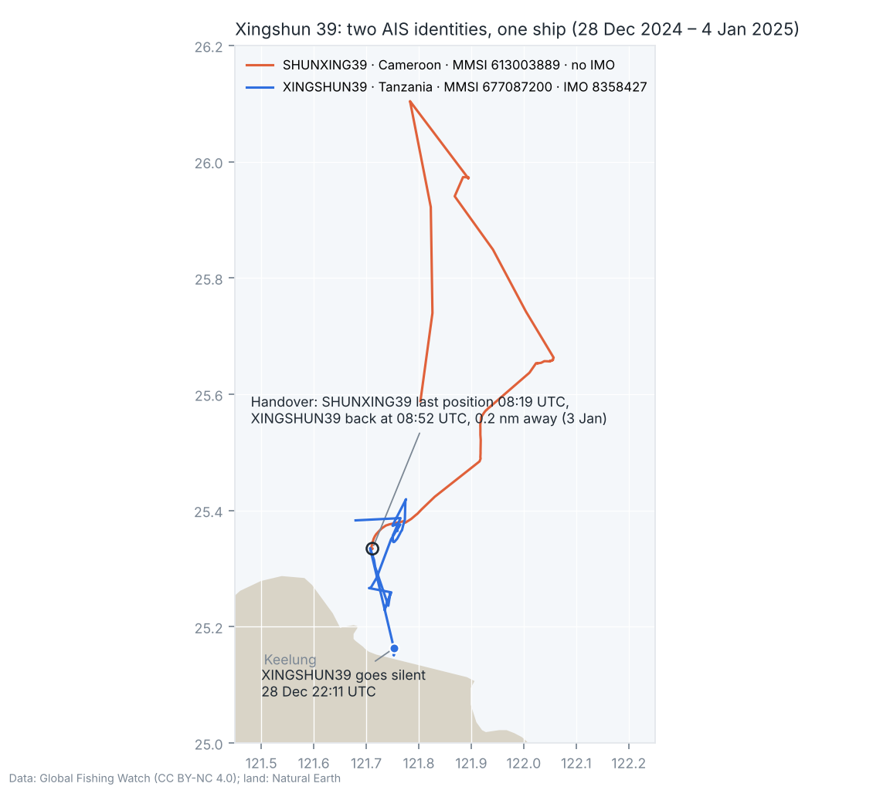
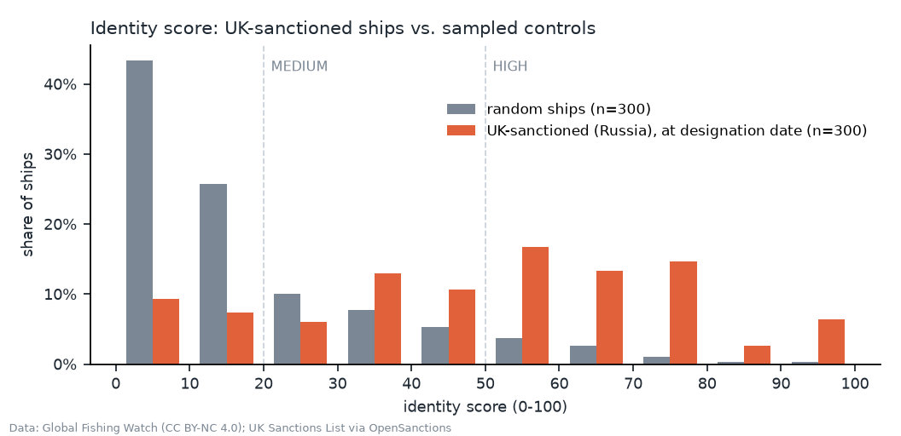

# Shadow Ship Check

[](https://github.com/janbarkemeyer/shadow-ship-check/actions/workflows/tests.yml)
[](https://janbarkemeyer.github.io/shadow-ship-check/)

I use this Python CLI to examine changes in ships' AIS identities and their tracks around reported
subsea cable incidents in Taiwan and the Baltic Sea.

I am a politics and economics student based in Taipei. I built Shadow Ship Check to investigate
identity changes reported around cable incidents. It runs explicit rules on data from
[Global Fishing Watch](https://globalfishingwatch.org) and lists the records behind each result.
I compare five incident cases, three control vessels and a separate sample of 300 UK-sanctioned
vessels against 300 controls.

I use the reports to compare the recorded identities, tracks and rule evidence for a known ship
or identity cluster. The bundled cases let me repeat that comparison offline. The results do not
establish intent, responsibility for damage or a probability of a future incident. HIGH means that several
rules fired; LOW can also reflect limited data.



*The Xingshun 39 case links a Tanzania identity with an IMO number and a Cameroon identity without
one. Their tracks show a possible handover at sea. Searching GFW by IMO alone misses the second
identity; this case links it manually by name and track evidence.*

## Results

Each incident case is scored twice: with a cut-off before the incident, and with the full bundled snapshot.
The first score uses earlier timestamps but today's identity links and registry matches. Flag
weights use the Paris MoU 2025 list, published in July 2026. This is a retrospective comparison,
not a reconstruction of what an analyst could have known at the time.

| Ship | Incident | Timestamp cut-off | Full data | What stands out at the cut-off |
|---|---|---|---|---|
| [Xingshun 39](cases/xingshun_39.md) | Keelung cable, Jan 2025 | 100 | 100 | Manually linked identity without IMO; overlapping dates and a possible handover off Keelung |
| [Hong Tai 58](cases/hong_tai_58.md) | Taiwan–Penghu cable, Feb 2025 | 100 | 100 | Identity cluster with conflicting tracks; some history may belong to another hull |
| [Eagle S](cases/eagle_s.md) | Estlink 2, Dec 2024 | 50 | 55 | Renamed and moved to a grey-listed flag in 2023; no GFW positions since 11 Dec |
| [NewNew Polar Bear](cases/newnew_polar_bear.md) | Balticconnector, Oct 2023 | 30 | 35 | Bought, renamed and reflagged < 4 months before |
| [Yi Peng 3](cases/yi_peng_3.md) | BCS / C-Lion1, Nov 2024 | 5 | 35 | No recent identity changes; reconstructed slow C-Lion1 crossing in the full snapshot |
| Finlandia, Yi Peng 5, Ever Liven | controls | 0–5 | 0–5 | Illustrative comparisons; only Finlandia is in the incident region |

For controls, the cut-off is the end of the analysis window, not an incident time. Yi Peng 5 is
near Taiwan and Ever Liven is in the western Pacific in their comparison windows; they are not
matched traffic from the incident regions.

Per-case reports: [reports/](reports/). Matsu (2023) is documented as the case without any published
ship identifier ([cases/matsu_2023.md](cases/matsu_2023.md)).

The separate comparison uses 300 vessels designated under the UK Russia sanctions regime and 300
random valid IMO numbers with a similar prefix distribution. Identities are cut off at each
reference date, and sanctions contribute no points. Median score 50 vs. 10; 54 % vs. 8 % reach HIGH;
AUC 0.83 (95 % bootstrap interval 0.80–0.86). Flag and registry signals alone reach almost the same
AUC. This measures separation of the sampled groups, not prediction of cable damage. One rule was
revised while preparing the sanctioned sample, so this is not an untouched validation set.
Details: [docs/evaluation.md](docs/evaluation.md).



## Quick start

I use Python 3.10 or newer in a virtual environment. The bundled examples run offline.

```bash
git clone https://github.com/janbarkemeyer/shadow-ship-check && cd shadow-ship-check
python3 -m venv .venv
source .venv/bin/activate
python -m pip install -e ".[dev]"  # runtime: standard library; pytest/ruff for development

ssc case all                 # the reference cases, offline from bundled data
ssc case yi_peng_3           # one case with all evidence
ssc eval                     # sanctioned-vessel comparison, offline
```

On Windows, create the environment with `py -m venv .venv` and activate it with
`.venv\Scripts\activate` in Command Prompt.
Live commands require GFW access. HTTP 401 means authentication is required; 403 means access was denied.
Neither response means that the vessel has no data.
The client accepts `GFW_API_TOKEN` for an authorised token, but access to the map-track endpoint is
not guaranteed. See [data and access](docs/data.md).

```bash
ssc search XINGSHUN39        # list matching identities, then choose an IMO or MMSI
ssc check 8358427 --start 2025-01-02 --end 2025-01-04 --also SHUNXING39 --md report.md
ssc check 8358427 --as-of 2025-01-02T12:00 --also SHUNXING39
```

With `--as-of` alone, the default window is the preceding 30 days. Times without an offset are UTC;
times with an offset are converted to UTC. With both `--end` and `--as-of`, the earlier value is the
effective cut-off. `--end` alone sets the movement window; it does not remove later identity
records. Use `--as-of` when both identity timestamps and positions must end at the cut-off.
An `--at` time at or before that cut-off keeps its position excerpt; a later one is omitted with
a note. Install from this checkout with `pip install -e` as above;
the offline commands read the repository's `data/` folder. Built wheels include the same data.

Example (`ssc case xingshun_39 --before-incident`, evidence shortened):

```
Shadow Ship Check - IMO 8358427
Score 100/100 (HIGH) (timestamps through 2025-01-02 12:00 UTC)
  Identity 80 · Flag & registry 40 · Behaviour 15
...
[+30] FLAG_CHANGE: 3 flag change(s)
        2024-03-04: CMR -> TZA (Paris MoU black, ITF flag of convenience)  [BAOLONG36 -> XINGSHUN39]  (recent)
...
[+20] CONCURRENT_IDENTITIES: Overlapping first/last dates for linked AIS identities
        2022-11-29 - 2023-02-10: BAOLONG36/CMR/613003836 and BAOLONG36/GUY/750342000
        2024-09-28 - 2025-01-02: XINGSHUN39/TZA/677087200 and SHUNXING39/CMR/613003889
[+20] IDENTITY_HANDOVER: Possible identity handover (one AIS track stops, another starts nearby)
        XINGSHUN39/TZA/677087200 stops 2024-12-28 22:11 UTC at 25.163,121.753 -> SHUNXING39/CMR/613003889
        (no IMO) starts 2024-12-29 02:44 UTC at 25.588,121.803 (273 min, 25.7 nm)
...
```

## How it works

1. `ssc check` searches GFW for the hull's identities, every MMSI it used and up to three recent
   names (identities without IMO are only found that way), then loads the AIS track of each identity.
2. It checks 17 signal types in three groups: *identity* (several names, borrowed or reused MMSIs, two
   identities at once, swaps at sea), *flag & registry* (reflagging weighted by the Paris MoU
   performance list, lost registry confirmation, UK sanctions list) and *behaviour* (AIS gaps,
   loitering, speed drops, slow crossings of cable routes from OpenStreetMap). Each rule produces
   points and the evidence behind them.
3. Points add up to a score from 0 to 100 (LOW < 20 ≤ MEDIUM < 50 ≤ HIGH), reported with
   sub-scores per group. `--as-of` filters dated identities and positions at a given time.

Rules, thresholds and their typical false positives: [docs/methodology.md](docs/methodology.md).
Data sources and formats: [docs/data.md](docs/data.md).

## Limitations

* Public GFW tracks are simplified (often one point per 60–90 min on open water). Short manoeuvres
  disappear; gaps can be coverage, not a switched-off transponder (see Eagle S).
* Historical cut-offs retain current GFW identity links, registry matches and fixed flag weights.
  Manually linked identities also use later knowledge. They cannot demonstrate an advance warning.
* The rules were written with these incidents in mind and adjusted against three control vessels.
  The separate evaluation covers identity rules only and was partly used during development.
  Behaviour rules have no independent validation.
* Cable routes are incomplete. OpenStreetMap has C-Lion1, BCS, Balticconnector and Estlink, but
  not TPKM-3 or the named trans-Pacific cables off Taiwan.
* Point values and HIGH/MEDIUM/LOW thresholds are heuristic. One sale can trigger `MULTI_IDENTITY`,
  `FLAG_CHANGE` and `REGISTRY_LOST` together. Movement signals can overlap too. The score is not a
  calibrated probability; read the evidence and group totals.
* The 8 % HIGH share applies to the 300 sampled controls. It is not a fleet-wide estimate or the
  false-alarm rate for cable incidents. A high score needs independent follow-up.
* Incident times are approximate and taken from public reporting.

## Repository layout

```
src/shadow_ship_check/   cli · gfw (API client, binary track decoder) · signals · watchlist
                         analyze · evaluate · report · cases · registries · geo
cases/                   case files with timelines, sources and open questions
reports/                 generated per-case reports (ssc case all --md reports; checked in CI)
data/                    GFW fixtures and evaluation set · OSM cable routes · UK sanctions list
docs/                    methodology, data, evaluation, figures
scripts/                 refresh_fixtures.py · make_figures.py · build_site.py
tests/                   unit, regression (cases + controls), evaluation, mocked end-to-end
```

## Roadmap

1. Area search: candidate AIS ships near a route in a time window; this would not establish responsibility (the Matsu case).
2. Automatic name variants (XINGSHUN ↔ SHUNXING) with track evidence before linking.
3. An out-of-sample test for the behaviour rules: tracks of ordinary ships crossing the same cables.
4. A second AIS source to separate coverage gaps from real AIS silence.

## Data and licences

Code: MIT. Vessel data: © Global Fishing Watch,
[CC BY-NC 4.0](https://creativecommons.org/licenses/by-nc/4.0/); non-commercial use with attribution.
Cable routes: © OpenStreetMap contributors, [ODbL](https://www.openstreetmap.org/copyright).
Sanctions list: UK Sanctions List (Open Government Licence v3.0) via OpenSanctions (CC BY-NC 4.0).
Land outlines in the figures: Natural Earth (public domain). Details in [docs/data.md](docs/data.md).
