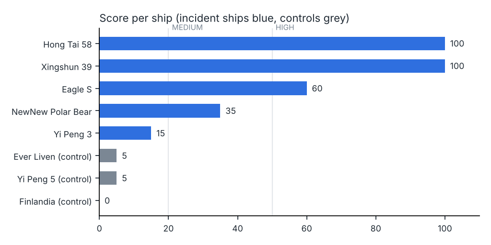

# Shadow Ship Check

[](https://github.com/janbarkemeyer/shadow-ship-check/actions/workflows/tests.yml)

**Checks a ship's AIS history for the camouflage patterns seen before subsea cable incidents in
Taiwan and the Baltic Sea – changing names, flag hopping, borrowed MMSIs, identity swaps at sea,
AIS gaps and slow loitering.**

Since 2023, subsea cables and a gas pipeline around Taiwan and in the Baltic Sea have repeatedly been
damaged by ships dragging their anchors. Several of the suspected ships had
changed name and flag shortly before, sailed under flags of convenience and broadcast inconsistent
AIS data. Shadow Ship Check turns those patterns into transparent rules, runs them on free data from
[Global Fishing Watch](https://globalfishingwatch.org), and documents five reference cases.

> The output is a list of indicators with evidence, for a human analyst to follow up. A high score
> is not evidence of sabotage. Most cases here are officially unresolved and are described as
> *suspected*.



## What it found in the reference cases

| Ship | Incident | Score | Strongest signals |
|---|---|---|---|
| [Xingshun 39](cases/xingshun_39.md) | Keelung cable, Jan 2025 | **100** | Second AIS identity without IMO (Cameroon) running in parallel with the Tanzania identity; hand-over between the two at sea, 0.2 nm apart; around the estimated time of the damage only the IMO-less identity was on air |
| [Hong Tai 58](cases/hong_tai_58.md) | Taiwan–Penghu cable, Feb 2025 | **100** | Three renamings in just over two years, an MMSI previously used by four other ships, identity swap off Korea, two identities of the hull reporting positions ~700 nm apart at the same time, 56 h stationary near the reported break and departure in the early morning of the break |
| [Eagle S](cases/eagle_s.md) | Estlink 2, Dec 2024 | **60** | Renamed and moved from Marshall Islands to Cook Islands on one day in 2023, registry confirmation lost, no GFW positions from 11 Dec 2024 to 7 Mar 2025 |
| [NewNew Polar Bear](cases/newnew_polar_bear.md) | Balticconnector, Oct 2023 | **35** | Bought, renamed and reflagged to Hong Kong < 4 months before; registry confirmation lost; renamed again in 2025 |
| [Yi Peng 3](cases/yi_peng_3.md) | BCS / C-Lion1, Nov 2024 | **15** | No identity camouflage; only a speed drop. Honest miss – behaviour checks need denser data and cable routes |
| [Matsu](cases/matsu_2023.md) | TPKM-2/3, Feb 2023 | – | Ships never named publicly; documented as the "no identifier" case |
| Finlandia, Yi Peng 5, Ever Liven | controls | 0–5 | Ordinary ships in the same waters and windows |

The Xingshun 39 identity swap, for example, is invisible if you only search by IMO number: the
Cameroon identity carries no IMO and only shows up by searching the reversed name.


## Quick start

```bash
git clone https://github.com/janbarkemeyer/shadow-ship-check && cd shadow-ship-check
pip install -e ".[dev]"

# re-run the reference cases offline from the bundled data
ssc case all --md reports
ssc case hong_tai_58

# check any ship live (IMO or MMSI), optionally with an incident time
ssc check 8358427 --start 2025-01-02 --end 2025-01-04 --at 2025-01-02T23:40 --also SHUNXING39 --md report.md
ssc search "eagle s"
```

`ssc check` searches the hull's identities, every MMSI it used and its recent names, loads the AIS
track of each identity, runs all checks and prints the evidence. `--cables cables.geojson` adds the
cable-proximity check (bring your own cable routes; see [docs/data.md](docs/data.md)). `--json` writes
machine-readable output, e.g. for the [prompts](prompts/).

No dependencies beyond the Python standard library (3.10+). `pytest` for the tests.

## The checks

| Code | What it looks for |
|---|---|
| `MULTI_IDENTITY` | several names/flags under one IMO in the last 5 years |
| `FLAG_CHANGE` | reflagging, especially into flags of convenience (ITF list), in the last 3 years or after the incident |
| `REGISTRY_LOST` / `NO_REGISTRY` | the identity in use is only self-reported AIS |
| `MMSI_FLAG_MISMATCH` | MMSI country code ≠ broadcast flag |
| `MMSI_REUSE` | the hull's MMSI also used by unrelated ships |
| `NAME_ON_OTHER_MMSI` | the hull's name broadcast under other ships' MMSIs |
| `IMO_HIDDEN` | known name + MMSI also broadcast without IMO |
| `CONCURRENT_IDENTITIES` | two identities of the hull active at the same time |
| `IDENTITY_HANDOVER` | one identity stops, another starts nearby shortly after |
| `PARALLEL_TRACKS` | two identities of the hull report positions far apart at the same time |
| `AIS_GAP` | missing positions, especially around the incident |
| `SLOW_LOITERING`, `SPEED_DROP`, `ZIGZAG` | crawling, unusual slowdowns, circling – no minimum distance from shore |
| `NEAR_CABLE_SLOW` | slow within 2 nm of a cable route (needs `--cables`) |

Rules, thresholds, points and their false positives: [docs/methodology.md](docs/methodology.md).

## Limitations

* **Public GFW tracks are simplified** (often one point per 60–90 min on open water). Short manoeuvres
  disappear; gaps can be coverage, not a switched-off transponder (see Eagle S).
* **Eight ships are not a validation.** The rules were tuned once against three control vessels.
  A proper test needs hundreds of ordinary ships, scored without further tuning.
* **No cable geometry is included**, so anchoring next to a cable is only listed, not scored, unless
  you provide routes.
* Identity linking depends on GFW. Ships that hide their IMO are only found through name and MMSI
  searches.
* Incident times are approximate and taken from public reporting.

## Repository layout

```
src/shadow_ship_check/   gfw.py (API client, binary track decoder) · signals.py (checks)
                         analyze.py · report.py · cli.py · cases.py · registries.py · geo.py
cases/                   case files with sources and open questions
reports/                 generated reports (ssc case all --md reports)
data/fixtures/           GFW snapshots used by cases and tests (CC BY-NC 4.0)
docs/                    methodology, data, figures
scripts/                 refresh_fixtures.py, make_figures.py
tests/                   unit, regression (cases + controls), mocked end-to-end
```

## Roadmap

1. Area search: all ships slow near a cable route in a time window (would make the Matsu case workable).
2. Larger evaluation set: ~300 ordinary ships in the Taiwan Strait and the Gulf of Finland.
3. Cable layer from official notices to mariners, where licensing allows.
4. Second AIS source to separate coverage gaps from real AIS silence.
5. Port detection, so that anchoring can be scored outside ports without a cable layer.

## Data and licence

Code: MIT. Vessel data: © Global Fishing Watch, [CC BY-NC 4.0](https://creativecommons.org/licenses/by-nc/4.0/) –
non-commercial use with attribution. Land outlines in the figures: Natural Earth (public domain).
Details in [docs/data.md](docs/data.md).
