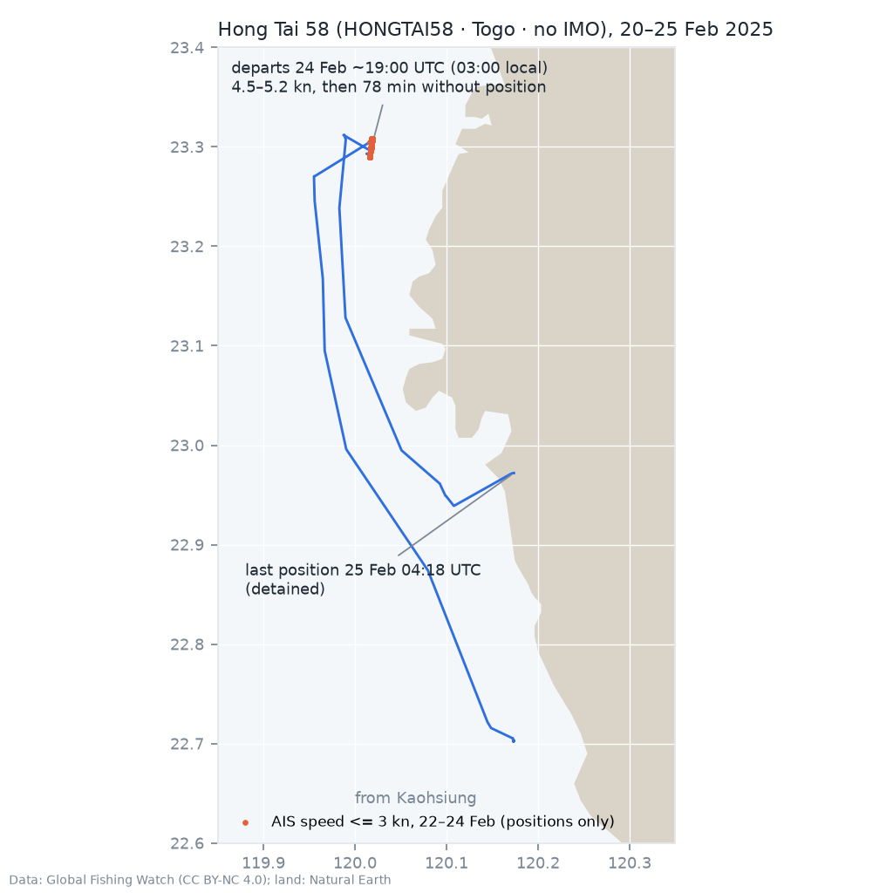

# Case file: Hong Tai 58: Taiwan–Penghu cable TPKM-3, 25 February 2025

| | |
|---|---|
| Incident | Break of the Taiwan–Penghu No. 3 cable, about 6 nm north-west of Jiangjun fishing port (Tainan) |
| Reported | Early morning of 25 Feb 2025 (local time, UTC+8); the coast guard detained the ship the same day |
| Status | The Tainan District Court imposed a three-year sentence on 12 Jun 2025 for damaging the cable with conditional intent. On 29 Aug 2025, the Tainan Branch of the Taiwan High Court dismissed the prosecution's appeal against the sentence and upheld it. The statement allowed a further appeal; later finality is not established here. |
| Hull | Cargo ship broadcasting as HONGTAI58 (Togo, MMSI 671756000) without IMO; GFW links this identity to IMO 8357069 by name and MMSI. The physical hull assignment remains uncertain. |
| Tool result | 100 HIGH before the incident, 100 with full data ([report](../reports/hong_tai_58.md)) |

## Identities in Global Fishing Watch

| Name | Flag | MMSI | AIS period | Note |
|---|---|---|---|---|
| JIN LONG 389 | China | 413762751 | 2012 to Oct 2022 | registry-confirmed |
| DONGSHUN3 | China | 413762751 | Oct 2022 to Sep 2023 | registry record only |
| HONGTAI58 | Togo | 671756000 | Jul 2023 to 15 Dec 2024 (with IMO) / Nov 2023 to 27 Feb 2025 (without IMO) | self-reported |
| HONGTA 8 | Tanzania | 677082100 | 15 Dec 2024 to 2 Jan 2025; 5 Jan to 5 Feb 2025 (as HONGTA8) | first period with IMO, second without IMO |
| HONGTAI58 | Togo | 671666000 | 27 Nov to 4 Dec 2024 | MMSI previously registered to another ship (KARAM, IMO 8116180) |
| HONGTAI58 | Togo | 671280000 | 25 to 26 Dec 2023 | MMSI also used by XINJINLIN6 |

MMSI 677082100 (HONGTA 8) was used before by four other ships (A DAL 3, GOLDEN SEA, YEKTA 3 and
LADY EMERALD), the last of them until November 2024.

The tracks below place linked HONGTAI58 identities in distant locations within the same hour.
This can reflect multiple hulls, incorrect linking or erroneous positions. The ship detained in
Taiwan was associated with the IMO-less identity. The history
under IMO 8357069 (JIN LONG 389 → DONGSHUN3 → HONGTAI58 → HONGTA 8) may therefore belong partly or
entirely to the *other* hull. The score describes the identity cluster, not proven facts about the
detained hull.

## What the tracks show

* On 15 Dec 2024 the IMO-carrying HONGTAI58 identity sends its last
  position at 02:01 UTC off the south coast of Korea (34.278 N, 128.456 E). At 03:17 UTC HONGTA 8
  (Tanzania, same IMO) starts at exactly the same position.
* On 17 Dec 2024 the IMO-less HONGTAI58 identity reports a position north of
  Taiwan (25.98 N, 120.91 E) while HONGTA 8 is 666 nm away off Korea; again on 12 Jan 2025, then 728 nm
  from the IMO-less HONGTA8 identity.
  Either two hulls share the HONGTAI58 identity data, or GFW merged two identities wrongly.
* The IMO-less HONGTAI58 identity has positions off Kaohsiung from mid-January,
  moves north on 22 Feb and reports low-speed positions near 23.30 N, 120.02 E between
  22 Feb 10:40 and 24 Feb 18:57 UTC. This spans roughly 56 hours but does not give continuous coverage.
  Reuters reported that the ship had anchored
  near the cable since the Saturday (22 Feb).
* At 18:57 UTC on 24 Feb (02:57 local, 25 Feb) the ship starts
  moving; at 19:10–19:12 UTC it makes 4.5–5.2 kn, then there is no position for 78 minutes. From 20:30
  UTC it heads south and ends at 04:18 UTC on 25 Feb near Tainan (22.97 N, 120.17 E), where it was
  detained.
* Before that, the identity lay off Kaohsiung for about five weeks.

## Warning signals (tool)

`MULTI_IDENTITY` (4), `FLAG_CHANGE` (China → Togo), `REGISTRY_LOST`, `MMSI_REUSE`, `NAME_ON_OTHER_MMSI`,
`IMO_HIDDEN`, `CONCURRENT_IDENTITIES`, `IDENTITY_HANDOVER`, `PARALLEL_TRACKS`, `SPEED_DROP`,
`CABLE_CROSSING_SLOW` (an unnamed pipeline crossed at 4 kn on 22 Feb, on the way to the anchorage).
`SLOW_LOITERING` lists stationary periods within the anchorage without scoring them. TPKM-3 is not in OpenStreetMap, so the
tool cannot test the anchorage against the damaged cable.

## Open questions

1. Exact time of the break. Chunghwa Telecom reported the fault at 03:03 local time on 25 Feb
   (19:03 UTC on 24 Feb), the time the tool uses; the report excerpt covers 16:03–22:03 UTC. The fault
   detection time need not be the moment of damage.
2. Is the detained hull IMO 8357069? Which hull was where in Dec 2024 / Jan 2025? The parallel tracks
   need a check against port-state records, the IMO number painted on the hull, or satellite imagery.
3. What happened between 27 Nov and 4 Dec 2024, when HONGTAI58 used the MMSI of KARAM? (Track not yet
   in the fixtures.)
4. Distance of the anchorage from the TPKM-3 route; needs the cable geometry.

## Sources

* GFW vessel search and tracks (fixture `data/fixtures/hong_tai_58.json`, fetched 26 Oct 2026)
* [Reuters via Baird Maritime, 25 Feb 2025](https://www.bairdmaritime.com/security/non-naval-security/taiwan-detains-china-linked-cargo-ship-after-undersea-cable-disconnected): detention, Togo flag, anchored near the cable since the weekend
* [Taiwan News (Chinese), 25 Feb 2025](https://www.taiwannews.com.tw/zh/news/6044971): break 6 nm north-west of Jiangjun fishing port
* [TechNews (Chinese), 25 Feb 2025](https://technews.tw/2025/02/25/taiwan-penghu-submarine-cable-no3/): Chunghwa Telecom reports the TPKM-3 fault at 03:03 local time
* [Reuters via Baird Maritime, 12 Jun 2025](https://www.bairdmaritime.com/security/incidents/piracy/taiwan-hands-jail-term-to-chinese-captain-for-damaging-subsea-cables): three-year sentence
* [Tainan District Court, 12 Jun 2025](https://www.judicial.gov.tw/tw/cp-1888-1341586-34f43-1.html): first-instance judgment, case 114年度訴字第235號
* [Court appeal statement, 29 Aug 2025](https://www.judicial.gov.tw/tw/cp-1888-1395515-e9707-1.html): prosecution's sentence appeal dismissed, three-year sentence upheld; further appeal allowed
