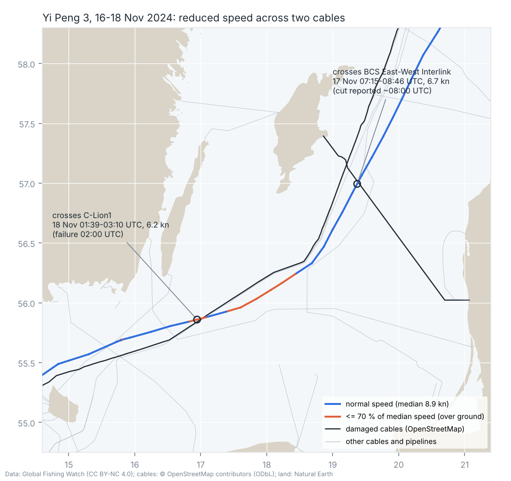

# Case file: Yi Peng 3: BCS East-West Interlink and C-Lion1, Baltic Sea, 17–18 November 2024

| | |
|---|---|
| Incident | BCS East-West Interlink (Lithuania–Gotland) cut around 10:00 local time on 17 Nov; C-Lion1 (Finland–Germany) lost traffic at 02:00 UTC on 18 Nov |
| Status | Suspected involvement. The linked reporting on the Swedish investigation does not establish whether the anchor was dropped deliberately; it describes a drag of about 180 nm. Swedish prosecutors were not allowed on board. |
| Hull | IMO 9224984, bulk carrier, China flag, Chinese operator |
| Tool result | 5 LOW before the incident, 35 MEDIUM with full data ([report](../reports/yi_peng_3.md)) |

## Identities in Global Fishing Watch

| Name | Flag | MMSI | AIS period | Registry-confirmed |
|---|---|---|---|---|
| AVRA | Greece | 240583000 | 2012 to Jul 2015 | no |
| AVRA | Liberia | 636017118 | Jul 2015 to Dec 2016 | yes |
| YI PENG 3 | China | 414270000 | since 2016 (with IMO since Jun 2020) | no |

One sale and reflagging to China eight years before the incident; no recent identity changes detected. The
comparison vessel Yi Peng 5 also has no scored recent identity changes. Its bundled positions
are near Taiwan, so it is not a local traffic control for the Baltic incident.

## What the track shows

* Speed drops from about 9 kn on 16 Nov to 6–7 kn from around 00:00 UTC on 17 Nov and stays there
  until the next morning; consistent with the ~1.5 days of anchor dragging described by Swedish
  investigators. The tool only flags the strongest part (3.9–4.3 kn, 17:59–19:30 UTC on 17 Nov, around
  56.16 N, 18.23 E); a 9 → 6.5 kn drop is within normal variation for its threshold.
* At 02:00 UTC on 18 Nov (C-Lion1 failure) the ship is at about 55.88 N, 17.08 E making 6 kn.
* Cable crossings (routes from OpenStreetMap, crossing time interpolated between two GFW positions):
  BCS East-West Interlink between 07:15 and 08:46 UTC on 17 Nov at 6.7 kn over ground; the cut was
  reported around 08:00 UTC; C-Lion 1 between 01:39 and 03:10 UTC on 18 Nov at 6.2 kn; the cable
  failed at 02:00 UTC. Both crossings fall into the slow phase, and both match the reported times.

* 08:25–09:35 UTC on 18 Nov: stop east of Bornholm (55.69 N, 15.80 E), then 9–10.5 kn.
* Some media reported that the ship's AIS was off for about 7.5 hours after
  Gotland and came back at 22:41 UTC south of Öland. GFW shows positions every ~90 minutes through that
  whole period. Possible explanations: satellite AIS received what coastal stations missed, GFW's
  simplified public track, or an error in the reporting. Needs full-resolution data before any claim.

## Warning signals (tool)

`CABLE_CROSSING_SLOW` (C-Lion 1 at 6.2 kn, against a median of 8.9 kn), `SPEED_DROP`, `REGISTRY_LOST` (only 5
points; confirmation lost in 2016). The BCS crossing at 6.7 kn is just above the 70 % threshold and is
not listed. Identity checks stay silent; before the incident the ship scores 5 (LOW).

The identity checks do not flag this case before the incident. Behaviour checks identify a speed
drop and a reconstructed slow cable crossing in the full snapshot. These are candidates for further
research, not an attribution of damage or an advance warning.

## Open questions

1. AIS-off period: GFW vs. media reports (see above).
2. Full-resolution AIS to locate the crossings exactly (the public track has one point every ~90 min).
3. A better speed-drop baseline (same ship, same route, previous voyages) instead of a fixed threshold.

## Sources

* GFW vessel search and tracks (fixture `data/fixtures/yi_peng_3.json`, fetched 26 Oct 2026)
* [Wikipedia: 2024 Baltic Sea submarine cable disruptions](https://en.wikipedia.org/wiki/2024_Baltic_Sea_submarine_cable_disruptions): times, AIS reports, investigations
* Cable routes: © OpenStreetMap contributors (ODbL), `data/cables/baltic.geojson`
* [The Maritime Executive: reporting on the Swedish investigation](https://maritime-executive.com/article/swedish-report-fails-to-find-evidence-of-sabotage-by-chinese-bulker)
